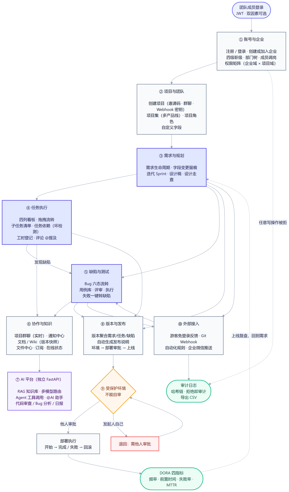
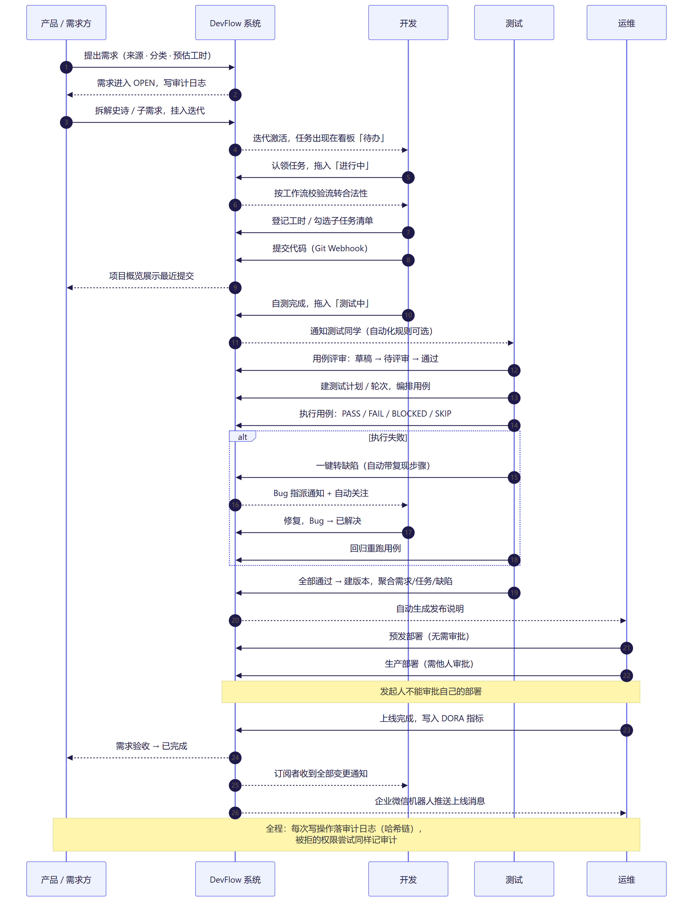
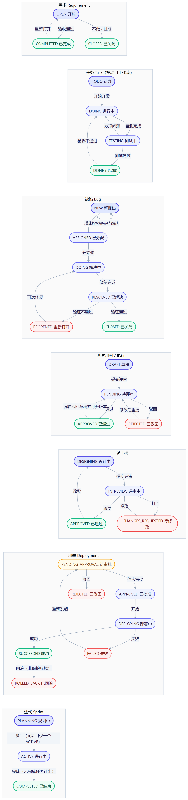

# DevFlow 业务流程与演示数据

> 一页看懂：**系统怎么流转**（三张图） + **演示数据怎么造**（一条命令）。

---

## 一、业务流程总览

从登录到上线的主干链路。每个方框是一个业务域，箭头是实际的状态推进方向。



虚线表示跨阶段的回流：上线复盘回到需求、权限拒绝写入审计、DORA 指标回看。

- 源文件：[diagrams/system-flow-overview.mmd](diagrams/system-flow-overview.mmd)
- 矢量图：[diagrams/system-flow-overview.svg](diagrams/system-flow-overview.svg)

> 三张图的 `.mmd` 源文件都在 `docs/diagrams/`，改完执行
> `node scripts/render-diagrams.mjs` 重新生成同名的 `.svg` / `.png`
> （需要 `npm i -D playwright-core mermaid`）。

---

## 二、跨角色协作时序

同一个需求在四类角色之间怎么接力。这是平台"协同"的核心——每一步都有人负责、每一步都留痕。



| 阶段 | 谁在做 | 系统做了什么 |
|------|--------|--------------|
| 需求提出 → 排期 | 产品 | 写审计日志；需求进入 OPEN；挂入迭代后任务出现在看板待办 |
| 认领 → 开发 | 开发 | 按项目工作流校验状态流转；工时与清单落库；Git push 落库去重 |
| 自测 → 交测 | 开发 → 测试 | 自动化规则触发通知（可选自动指派） |
| 评审 → 执行 | 测试 | 用例版本快照；执行记录带当时的用例版本 |
| 失败 → 转缺陷 | 测试 | 自动拼装复现步骤回填 `bug_id`；Bug 指派通知 + 自动关注 |
| 修复 → 回归 | 开发 → 测试 | Bug 状态流转受"仅负责人/报告人"约束 |
| 全部通过 → 建版本 | 测试 / 运维 | 版本聚合需求/任务/缺陷；发布说明自动生成 |
| 预发 → 生产 | 运维 | **受保护环境必须他人审批**，发起人不能自审 |
| 上线 → 验收 | 产品 | DORA 四指标落库；订阅者收到通知；企业微信推送 |

---

## 三、各业务对象的状态机

七条独立的状态机，决定了按钮什么时候可用、什么流转会被拒绝。



| 对象 | 状态数 | 关键约束 |
|------|--------|----------|
| 需求 | 3 | 已完成可重新打开；关闭为终态 |
| 任务 | 4 | 状态取值来自**项目自己的**工作流配置，可自定义 |
| Bug | 6 | 状态变更仅负责人/报告人可操作；游客提交先进待确认队列 |
| 测试用例 | 4 | 编辑即生成版本快照；执行记录绑定当时的版本号 |
| 设计稿 | 4 | 改稿会自动回到"设计中"，旧批准不再生效 |
| 部署 | 7 | 自审 403；受保护环境回滚必须重新走审批 |
| 迭代 | 3 | 同项目同时只有一个 ACTIVE；完成时未完成任务自动迁出 |

---

## 四、生成全场景演示数据

### 一条命令

```bash
node scripts/seed-demo-data.mjs
```

默认打 `http://localhost:8080/api/v1`，可用 `BASE=` 覆盖：

```bash
BASE=http://localhost:18090/api/v1 node scripts/seed-demo-data.mjs
```

脚本会打印一份清单（账号、企业/项目/迭代/版本 ID、前端直达链接）。

### 造出来的东西

**176+ 步操作，覆盖 README 里列出的每一个功能点**：

| 域 | 数据 |
|----|------|
| 账号与组织 | 5 个账号（超管/管理员/经理/成员/测试）、1 个企业、3 级部门树、成员调岗 |
| 项目 | 1 个项目集、主项目 + 1 个归档示例项目、4 个项目角色成员 |
| 自定义字段 | USER / SELECT / CHECKBOX 三种类型 |
| 需求 | 史诗 + 3 条子需求（已完成 / 进行中 / 已关闭）、字段变更记录、需求↔任务关联 |
| 迭代 | 3 个（已激活 / 下一迭代 / 上一迭代） |
| 任务 | 10 条覆盖四列看板、2 条依赖、3 个清单项、3 条工时、评论 @提及、自定义字段值 |
| Bug | 6 条覆盖六态、5 条评论、订阅 |
| 测试 | 5 条用例（评审四态全覆盖）、计划 + 轮次、执行四态（PASS/FAIL/BLOCKED/SKIP）、失败转缺陷 |
| 文档 | 技术方案（2 个版本 + 恢复 + 评论）、Wiki 树（根 + 2 子节点）、会议记录 |
| 文件 | 1 个上传附件 |
| 聊天 | 5 条消息 + 编辑 + 表情 + 已读 |
| 版本发布 | 1 个版本 + 自动发布说明 + 版本统计 |
| 部署 | 2 个环境（预发无需审批 / 生产需审批）、成功链路、失败链路、生产完整审批链路、DORA |
| 设计 | 1 个设计稿（状态流转 + 2 个版本）、走查（PASS/FAIL/NA + 转缺陷 + 结束） |
| 自动化 | 3 条规则（BUG_CREATED / CASE_FAIL / TASK_DONE） |
| 筛选器 / 订阅 | 2 个保存筛选器、4 条订阅 |
| 游客通道 | 生成链接 → 提 Bug → 提建议 → 站内接受/拒绝 → 转缺陷 |
| Git | 4 个提交落库 + 重复推送验证去重 |
| 治理 | 审计链自检、通知偏好批量开关 |

### 演示账号

密码统一 `Demo@2026`：

| 账号 | 职级 | 姓名 |
|------|------|------|
| `demo_owner` | SUPER_ADMIN | 林知远 |
| `demo_admin` | ADMIN | 周慕青 |
| `demo_manager` | MANAGER | 陈砚 |
| `demo_member` | MEMBER | 苏遥 |
| `demo_tester` | MEMBER | 何以宁 |

> 想演示"越权被拒"：用 `demo_member` 登录去删项目，会拿到 403 并写入审计日志。

### 重复运行

脚本对**企业、用户、部门**做"已存在则复用"，业务对象每次新建。所以可以反复跑，
但每次都会多出新的项目/需求/Bug。需要干净数据时先重建库：

```bash
mysql -h127.0.0.1 -uroot -p -e "DROP DATABASE devflow; CREATE DATABASE devflow CHARACTER SET utf8mb4"
```

### 看完数据先看哪里

依次打开这几个页面，能最快把上表的内容都过一遍：

1. `/projects` — 项目卡片（含归档态）
2. `/projects/{id}` — 概览：任务分布、燃尽图、最近动态、最近提交
3. `/projects/{id}?tab=tasks` — 四列看板、迭代切换、清单/工时/依赖
4. `/projects/{id}?tab=bugs` — 六态分布、游客提交待确认
5. `/projects/{id}?tab=testing` — 通过率 40%、五种执行结果
6. `/projects/{id}?tab=releases` — 发布说明已自动生成
7. `/projects/{id}?tab=deployments` — DORA 指标、审批链路
8. `/enterprise` — 成员、部门架构、审计链校验
9. `/chat` — 项目群聊消息
10. `/ai` — 对话 / Agent / 知识库 / Code Review
